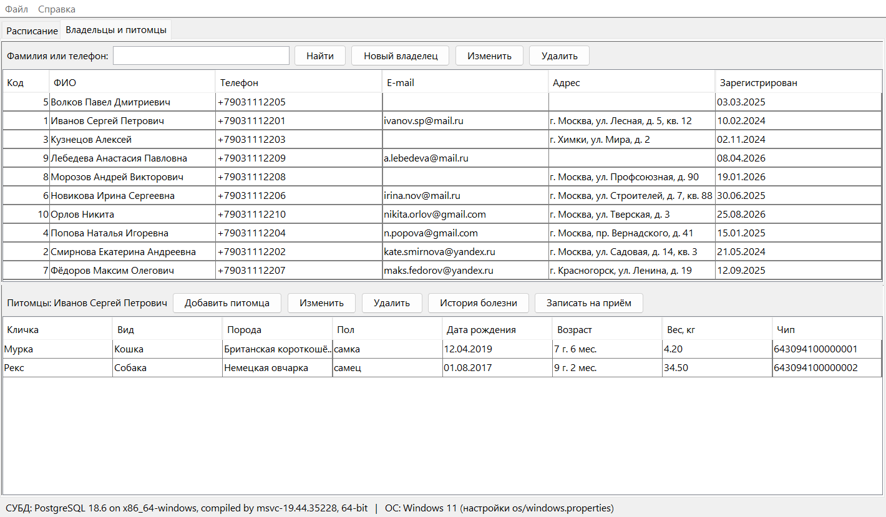

# ВетКлиник — информационная система ветеринарной клиники

**Репозиторий:** https://github.com/Genaliev2004/VetClinic

Итоговый проект по курсам «Базы данных» и «Системный подход в разработке ПО».
Java-приложение с графическим интерфейсом (Swing) работает с реляционной базой
данных из **8 таблиц** через **чистый JDBC** (без ORM и фреймворков) и умеет
работать с **двумя СУБД — PostgreSQL и Microsoft SQL Server**. Параметры
подключения берутся из файла настроек.



## Содержание

1. [Состав репозитория](#состав-репозитория)
2. [Что нужно установить](#что-нужно-установить)
3. [Развёртывание в Windows](#развёртывание-в-windows)
4. [Развёртывание в Linux (Ubuntu)](#развёртывание-в-linux-ubuntu)
5. [Настройки подключения](#настройки-подключения)
6. [Тесты](#тесты)
7. [Работа с программой](#работа-с-программой)
8. [Если что-то не работает](#если-что-то-не-работает)
9. [Ветки репозитория](#ветки-репозитория)

## Состав репозитория

```
VetClinic/
├── README.md                  — этот файл
├── config/
│   ├── db.properties          — подключение к PostgreSQL и SQL Server, СУБД по умолчанию
│   └── os/                    — настройки, зависящие от ОС (windows / linux / macos)
├── sql/
│   ├── postgresql/            — 00 база и роль, 01 схема, 02 данные, 03 тесты ограничений, 04 запросы
│   └── mssql/                 — то же для Microsoft SQL Server
├── app/                       — Java-приложение (Maven-проект, открывается в Eclipse / IntelliJ IDEA)
│   ├── mvnw, mvnw.cmd         — Maven Wrapper: Maven ставить не нужно
│   └── src/main/java/ru/vetclinic/{config,db,model,dao,service,ui}
├── scripts/                   — развёртывание БД, сборка и запуск (.bat — Windows, .sh — Linux)
└── docs/                      — этапы проекта, ER-диаграммы, план тестирования, снимки окон
```

Документация по этапам: [заявка темы](docs/00_forum_post.md) ·
[предметная область](docs/01_domain.md) · [логическая модель](docs/02_logical_model.md) ·
[реляционная модель и НФБК](docs/03_relational_model.md) · [приложение](docs/04_application.md) ·
[план тестирования](docs/05_test_plan.md) · [проверка одногруппником](docs/06_peer_testing.md)

## Что нужно установить

| Что | Версия | Проверка |
|-----|--------|----------|
| JDK | 17 или новее (код собирается под Java 17; проверено на Java 25 в Windows и Java 21 в Ubuntu) | `java -version` |
| Git | любая | `git --version` |
| PostgreSQL **и/или** SQL Server | PostgreSQL 14+ (проверено на 18), SQL Server 2019+ (проверено на 2022) | `psql --version`, `sqlcmd -?` |
| Интернет при первой сборке | — | Maven Wrapper скачает Maven 3.9 и JDBC-драйверы |

Для проверки достаточно **одной** СУБД.

## Развёртывание в Windows

```bat
git clone https://github.com/Genaliev2004/VetClinic.git VetClinic
cd VetClinic
```

### 1. База данных

**PostgreSQL.** Скрипт спросит пароль суперпользователя `postgres`, который
задавался при установке PostgreSQL:

```bat
scripts\deploy_postgresql.bat
```

Скрипт создаёт роль `vet_app` (пароль `VetApp_2026`) и базу `vet_clinic`,
затем таблицы, тестовые данные и запускает проверку ограничений. В конце
должно быть `pass = 34, fail = 0`. Если `psql.exe` не найден, передайте путь
к нему: `scripts\deploy_postgresql.bat "C:\Program Files\PostgreSQL\18\bin\psql.exe"`.

**SQL Server** (вход под текущей учётной записью Windows):

```bat
scripts\deploy_mssql.bat
rem для именованного экземпляра: scripts\deploy_mssql.bat localhost\SQLEXPRESS
```

В конце должно быть `Итого: PASS = 34, FAIL = 0`.

Скрипты можно выполнить и вручную в pgAdmin/DBeaver/SSMS по порядку:
`sql/<СУБД>/00_create_database.sql`, затем `01_schema.sql`, `02_data.sql` и
`03_constraint_tests.sql` (01–03 — в базе `vet_clinic`).

### 2. Сборка и запуск

```bat
scripts\build.bat
scripts\run.bat
```

Сборка создаёт `app\target\vetclinic.jar` и `app\target\native\mssql-jdbc_auth-*.dll`.
DLL нужна для Windows-аутентификации SQL Server. В окне входа выберите СУБД,
нажмите «Подключиться», выберите роль и нажмите «Войти».

## Развёртывание в Linux (Ubuntu)

Проверено на Ubuntu 26.04.1 LTS (OpenJDK 21, PostgreSQL 18.6): 72 теста пройдено, тесты SQL Server пропускаются.

Одной командой: она поставит JDK 17 и PostgreSQL, создаст базу, прогонит тесты
и соберёт приложение.

```bash
git clone https://github.com/Genaliev2004/VetClinic.git VetClinic
cd VetClinic
bash scripts/setup_ubuntu.sh
bash scripts/run.sh
```

Или по шагам, если JDK и PostgreSQL уже установлены:

```bash
bash scripts/deploy_postgresql.sh   # шаг 00 выполняется через sudo -u postgres
bash scripts/build.sh               # или: bash scripts/build.sh test
bash scripts/run.sh
```

В Linux используются настройки `config/os/linux.properties`: внешний вид
Nimbus, шрифт DejaVu Sans, разделитель строк LF. Windows-аутентификация
SQL Server там недоступна.

## Настройки подключения

Файл `config/db.properties`:

```properties
db.active=postgresql                       # СУБД по умолчанию: postgresql или mssql
postgresql.url=jdbc:postgresql://localhost:5432/vet_clinic
postgresql.user=vet_app
postgresql.password=VetApp_2026
mssql.url=jdbc:sqlserver://localhost:1433;databaseName=vet_clinic;encrypt=true;trustServerCertificate=true
```

Свои значения (другой порт, пароль, экземпляр SQL Server) удобнее записать в
`config/local.properties`. Этот файл не попадает в git и перекрывает
`db.properties`. Пример:

```properties
postgresql.url=jdbc:postgresql://localhost:5433/vet_clinic
mssql.url=jdbc:sqlserver://localhost\\SQLEXPRESS;databaseName=vet_clinic;encrypt=true;trustServerCertificate=true
```

Порядок чтения настроек: `config/os/<ОС>.properties` → `config/db.properties` →
`config/local.properties` → параметры `-Dключ=значение`. Каждый следующий
источник важнее предыдущего.

**SQL Server с логином и паролем** (например, у одногруппника включён
смешанный режим или проверка идёт из Linux):

1. раскомментируйте блок `CREATE LOGIN vet_app` в `sql/mssql/00_create_database.sql`;
2. добавьте в `config/local.properties` строку `mssql.integratedSecurity=false`.

## Тесты

| Что | Команда | Ожидаемый результат |
|-----|---------|---------------------|
| Ограничения БД (SQL) | входят в `deploy_*` | `PASS = 34, FAIL = 0` |
| Модульные + интеграционные (JUnit 5) | `scripts\build.bat test` / `bash scripts/build.sh test` | Windows с обеими СУБД: `Tests run: 96, Failures: 0` |

Интеграционные тесты выполняются на каждой СУБД из списка `test.databases`.
Тесты недоступной СУБД пропускаются (`Skipped`). Выбрать одну СУБД:
`cd app && mvnw.cmd test -Dtest.databases=postgresql`. Тестовые данные тесты не
меняют: каждая транзакция в конце откатывается.

Подробности — в [плане тестирования](docs/05_test_plan.md).

## Работа с программой

| Роль | Что делает |
|------|-----------|
| **Администратор** | врачи (приём, увольнение), прайс услуг, справочники видов и специализаций, отчёты: выручка врачей и популярные услуги |
| **Регистратор** | владельцы и питомцы, история болезни, запись на свободное время, отмена записи, счёт |
| **Врач** | свои приёмы на день, проведение приёма (диагноз + услуги), счёт |

Для демонстрации удобно выбрать дату **21.10.2026**: на неё в тестовых данных
есть записи к врачу Соколовой.

## Если что-то не работает

| Симптом | Решение |
|---------|---------|
| «Нет подключения к базе данных… password authentication failed» | неверный пароль `vet_app` или база не создана — выполните `deploy_postgresql` |
| SQL Server: «This driver is not configured for integrated authentication» | запускайте через `scripts\run.bat` (он передаёт `-Djava.library.path=app\target\native`) и соберите проект (`build.bat`) |
| SQL Server: «connection refused» на порту 1433 | включите TCP/IP в SQL Server Configuration Manager или укажите порт/экземпляр в `config/local.properties` |
| `mvnw.cmd`: «Cannot start maven from wrapper» | путь к профилю содержит кириллицу или пробелы — задайте `set MAVEN_USER_HOME=C:\m2` и повторите |
| Кириллица в консоли Windows «кракозябрами» | на работу программы не влияет; `run.bat` переключает консоль на UTF-8 |
| Linux: `apt update` выдаёт 404 (поддержка выпуска Ubuntu закончилась) | `setup_ubuntu.sh` сам переключит apt на old-releases.ubuntu.com |
| Linux: `Permission denied` для `mvnw` | `chmod +x app/mvnw` (это делает `build.sh`) |

## Ветки репозитория

| Ветка | Назначение |
|-------|-----------|
| `main` | стабильная версия для сдачи (теги `v1.0` – `v1.0.3`) |
| `develop` | интеграционная ветка: сюда сливаются feature-ветки |
| `feature/database` | этапы 1–4: описание, модели, скрипты PostgreSQL и SQL Server |
| `feature/java-app` | клиентское приложение |
| `feature/tests` | модульные и интеграционные тесты, скрипты сборки и запуска, документация |
| `feature/report` | отчёт по проекту |
| `fix/ubuntu-setup` | исправления по итогам проверки в Ubuntu |
| `docs/linux-results` | результаты проверки в Ubuntu |
| `docs/github` | ссылка на репозиторий GitHub |

Слияние идёт через `git merge --no-ff`, поэтому в истории видно, какая работа
выполнялась в какой ветке (`git log --graph --oneline --all`).

---
Автор: Алиев Геннадий Артемович, группа 5130902/30201. Проверяющий: _Фамилия И. О., группа_.
