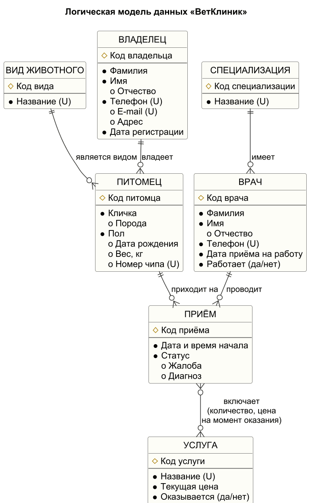

# Этап 2. Логическая модель данных

Диаграмма: `docs/diagrams/logical_model.png` (исходник `logical_model.puml`,
нотация IE — «воронья лапка»). Обозначения: `#` — уникальный идентификатор,
`•` — обязательный атрибут, `o` — необязательный, `(U)` — уникальный атрибут.

## 2.1. Сущности и атрибуты

| Сущность | Идентификатор | Обязательные атрибуты | Необязательные | Уникальные |
|----------|---------------|------------------------|----------------|------------|
| ВИД ЖИВОТНОГО | Код вида | Название | — | Название |
| ВЛАДЕЛЕЦ | Код владельца | Фамилия, Имя, Телефон, Дата регистрации | Отчество, E-mail, Адрес | Телефон, E-mail |
| ПИТОМЕЦ | Код питомца | Кличка, Пол | Порода, Дата рождения, Вес, Номер чипа | Номер чипа |
| СПЕЦИАЛИЗАЦИЯ | Код специализации | Название | — | Название |
| ВРАЧ | Код врача | Фамилия, Имя, Телефон, Дата приёма на работу, Работает | Отчество | Телефон |
| УСЛУГА | Код услуги | Название, Текущая цена, Оказывается | — | Название |
| ПРИЁМ | Код приёма | Дата и время начала, Статус | Жалоба, Диагноз | — |

Идентификаторы — суррогатные (числовые коды). Естественные ключи (телефон,
номер чипа, название) могут меняться или отсутствовать, поэтому они объявлены
альтернативными уникальными ключами, а не первичными.

## 2.2. Связи

| Связь | Тип | Обязательность |
|-------|-----|----------------|
| ВЛАДЕЛЕЦ *владеет* ПИТОМЦЕМ | 1 : N | у питомца владелец обязателен; у владельца питомцев может ещё не быть |
| ВИД ЖИВОТНОГО *является видом* ПИТОМЦА | 1 : N | вид у питомца обязателен |
| СПЕЦИАЛИЗАЦИЯ *имеется у* ВРАЧА | 1 : N | у врача ровно одна специализация |
| ПИТОМЕЦ *приходит на* ПРИЁМ | 1 : N | у приёма питомец обязателен |
| ВРАЧ *проводит* ПРИЁМ | 1 : N | у приёма врач обязателен |
| ПРИЁМ *включает* УСЛУГУ | M : N | у приёма может не быть услуг (запланирован/отменён), услуга может ни разу не оказываться |

Связь «ПРИЁМ — УСЛУГА» имеет собственные атрибуты: **количество** и **цену на
момент оказания**. Они не принадлежат ни приёму, ни услуге, поэтому при
переходе к реляционной модели связь превращается в отдельную таблицу
(см. этап 3).

## 2.3. Супертипы и арки

* **Супертип «Человек»** для ВЛАДЕЛЬЦА и ВРАЧА не вводился. Общие атрибуты у них
  есть (ФИО, телефон), но это разные роли с разными связями и правилами:
  врач не бывает владельцем в рамках системы, у владельца нет специализации
  и даты приёма на работу. Общая таблица добавила бы дискриминатор и
  множество NULL-полей, не дав выигрыша.
* **Арки** (исключающие связи) не потребовались: ни у одной сущности нет
  связи «либо с А, либо с Б».

## 2.4. Ограничения, которые нельзя показать на диаграмме

Они перечислены в `docs/01_domain.md` (BR-01…BR-23) и реализуются CHECK,
UNIQUE, уникальными индексами с условием и триггерами (этап 3–4).
