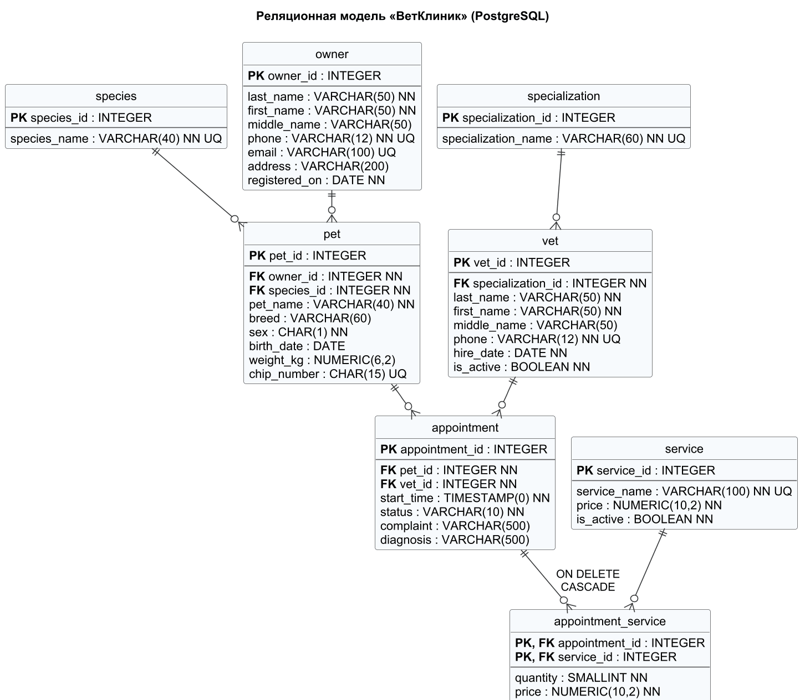

# Этап 3. Реляционная модель и нормализация

Диаграмма: `docs/diagrams/relational_model.png` (исходник `relational_model.puml`).
Скрипты: `sql/postgresql/01_schema.sql`, `sql/mssql/01_schema.sql`.

## 3.1. Переход от логической модели

* Каждая сущность стала таблицей, идентификатор — первичным ключом
  (`INTEGER` с автогенерацией: `GENERATED BY DEFAULT AS IDENTITY` в PostgreSQL,
  `IDENTITY(1,1)` в SQL Server).
* Связи 1:N стали внешними ключами на стороне «многие» (`pet.owner_id`,
  `pet.species_id`, `vet.specialization_id`, `appointment.pet_id`,
  `appointment.vet_id`), все `NOT NULL`, потому что связи обязательны.
* Связь M:N «ПРИЁМ — УСЛУГА» разрешена таблицей `appointment_service`
  с составным первичным ключом `(appointment_id, service_id)` и атрибутами связи
  `quantity` и `price`. В итоге 7 сущностей + 1 таблица связи = **8 таблиц**.

## 3.2. Выбор типов данных

| Данные | PostgreSQL | SQL Server | Почему так |
|--------|-----------|------------|------------|
| Идентификаторы | `INTEGER` identity | `INT IDENTITY` | целые числа, не строки; 2·10⁹ значений достаточно |
| ФИО, клички, названия | `VARCHAR(40…100)` | `NVARCHAR(40…100)` | короткие строки; в SQL Server `NVARCHAR` нужен для кириллицы (Unicode) |
| Телефон | `VARCHAR(12)` | `VARCHAR(12)` | строка `+7XXXXXXXXXX`: ведущий `+`, арифметика не нужна |
| E-mail | `VARCHAR(100)` | `VARCHAR(100)` | только латиница |
| Пол | `CHAR(1)` | `CHAR(1)` | фиксированный код `M`/`F` |
| Номер чипа | `CHAR(15)` | `CHAR(15)` | ровно 15 цифр (ISO 11784), может начинаться с нуля — не число |
| Даты | `DATE` | `DATE` | время не нужно |
| Начало приёма | `TIMESTAMP(0)` | `DATETIME2(0)` | дата и время с точностью до секунды |
| Вес | `NUMERIC(6,2)` | `DECIMAL(6,2)` | точное десятичное, до 9999,99 кг |
| Цены, суммы | `NUMERIC(10,2)` | `DECIMAL(10,2)` | деньги — только точный тип, не `FLOAT` |
| Количество | `SMALLINT` | `SMALLINT` | 1…100 |
| Признаки | `BOOLEAN` | `BIT` | да/нет |
| Статус приёма | `VARCHAR(10)` + CHECK | `VARCHAR(10)` + CHECK | 3 значения; отдельная таблица не нужна |
| Жалоба, диагноз | `VARCHAR(500)` | `NVARCHAR(500)` | ограниченный текст, не LOB (`TEXT`/`MAX`) |

## 3.3. Ограничения

| Вид | Где |
|-----|-----|
| PRIMARY KEY | во всех 8 таблицах |
| FOREIGN KEY | 7 штук; `ON DELETE CASCADE` только для `appointment_service → appointment`, остальные NO ACTION (BR-20, BR-21) |
| UNIQUE | названия справочников, телефоны, e-mail, номер чипа |
| Уникальный индекс с условием | `(vet_id, start_time)` и `(pet_id, start_time)` среди неотменённых приёмов (BR-12, BR-13); в SQL Server также e-mail и чип (`WHERE … IS NOT NULL`) |
| CHECK | непустые строки, форматы телефона/e-mail/чипа, пол, диапазоны дат, вес, цена, количество, слот приёма, статус, диагноз у проведённого приёма |
| DEFAULT | дата регистрации владельца, `is_active`, статус `SCHEDULED`, количество 1 |
| Триггеры | `trg_appointment_rules` (BR-15, BR-16, BR-17), `trg_appointment_service_rules` (BR-17) |
| Представление | `v_appointment_total` — сумма счёта по каждому приёму |

## 3.4. Доказательство соответствия НФБК

**Определение.** Отношение находится в нормальной форме Бойса—Кодда, если
для каждой нетривиальной функциональной зависимости `X → Y` детерминант `X`
является суперключом.

Сначала проверим 1НФ: все атрибуты атомарны. ФИО разбито на три атрибута.
Адрес хранится одной строкой, потому что по его частям система не ищет и не
группирует. Повторяющихся групп нет: несколько услуг приёма вынесены в
отдельную таблицу.

Ниже для каждой таблицы приведены все нетривиальные функциональные
зависимости (ФЗ) и возможные ключи. Если детерминант каждой ФЗ — возможный
ключ, таблица в НФБК.

| Таблица | Возможные ключи | Функциональные зависимости | Вывод |
|---------|-----------------|----------------------------|-------|
| `species` | `{species_id}`, `{species_name}` | `species_id → species_name`; `species_name → species_id` | оба детерминанта — ключи ⇒ НФБК |
| `specialization` | `{specialization_id}`, `{specialization_name}` | аналогично | НФБК |
| `owner` | `{owner_id}`, `{phone}`, `{email}`* | `owner_id → все`; `phone → все`; `email → все` (для непустых) | детерминанты — ключи ⇒ НФБК |
| `pet` | `{pet_id}`, `{chip_number}`* | `pet_id → owner_id, species_id, pet_name, breed, sex, birth_date, weight_kg, chip_number`; `chip_number → все` | НФБК |
| `vet` | `{vet_id}`, `{phone}` | `vet_id → все`; `phone → все` | НФБК |
| `service` | `{service_id}`, `{service_name}` | `service_id → service_name, price, is_active`; `service_name → все` | НФБК |
| `appointment` | `{appointment_id}` | `appointment_id → pet_id, vet_id, start_time, status, complaint, diagnosis` | НФБК |
| `appointment_service` | `{appointment_id, service_id}` | `appointment_id, service_id → quantity, price` | НФБК |

\* `email` и `chip_number` необязательны: это ключи только для строк, где значение
задано (уникальность обеспечена ограничением/индексом).

**Зависимости, которых нет (и почему это важно).**

1. `breed ↛ species_id`. Порода хранится свободным текстом, и одна и та же
   строка («Беспородная») встречается у разных видов. Транзитивной зависимости
   `pet_id → breed → species_id` нет.
2. `(vet_id, start_time) ↛ appointment_id` во всём отношении. Пара уникальна
   только среди **неотменённых** приёмов: в отменённый слот можно записаться
   повторно (тест T22). Поэтому это не ключ отношения, а ограничение,
   реализованное уникальным индексом с условием. Неключевого детерминанта нет.
3. `service_id ↛ price` в `appointment_service`. Цена в строке счёта — цена
   **на момент оказания**, она может отличаться от текущей цены услуги и от
   цены в других приёмах. Например, «Первичный осмотр» в тестовых данных стоит
   1000 ₽ (приёмы 1, 2), 1100 ₽ (приём 3) и 1200 ₽ (остальные приёмы).
   Значит, `price` зависит от всего ключа `(appointment_id, service_id)`, а не
   от его части. Нарушения 2НФ нет.
4. Нет вычисляемых и дублирующих атрибутов. Сумма счёта не хранится,
   а считается представлением `v_appointment_total`. В `pet` нет телефона
   владельца, в `vet` нет названия специализации: они получаются соединением.
   Значит, нет и транзитивных зависимостей (3НФ).

Каждая таблица находится в 1НФ. Каждая нетривиальная ФЗ имеет детерминантом
возможный ключ. Следовательно, **все 8 таблиц находятся в НФБК** (а значит, и
в 3НФ, и в 2НФ).
