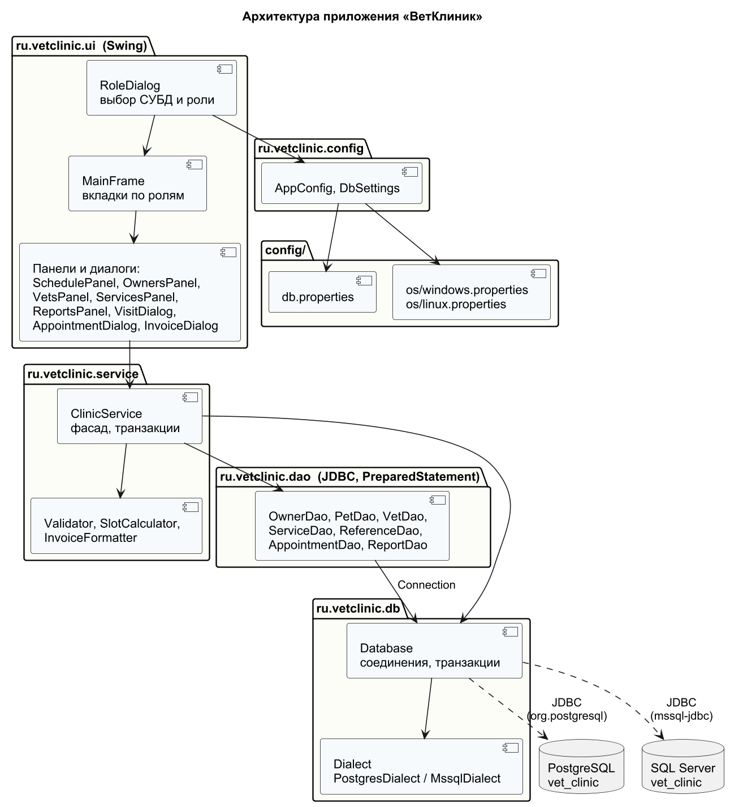

# Этап 5. Клиентское приложение

## 5.1. Технологии

* Java 17+ (проверено на Java 25), графический интерфейс — Swing.
* Доступ к данным — только JDBC: `DriverManager`, `PreparedStatement`, `ResultSet`,
  транзакции `setAutoCommit(false)` / `commit()` / `rollback()`.
  ORM и фреймворки (Hibernate, Spring, MyBatis и т. п.) не используются.
* Драйверы: `org.postgresql:postgresql` 42.7.13 и `com.microsoft.sqlserver:mssql-jdbc` 13.6.0.
* Сборка — Maven через Maven Wrapper (`app/mvnw`, `app/mvnw.cmd`): Maven ставить не нужно.
  Проект открывается в Eclipse («Import → Existing Maven Projects») и IntelliJ IDEA.

## 5.2. Архитектура



| Пакет | Назначение |
|-------|-----------|
| `ru.vetclinic.config` | `AppConfig` читает настройки из нескольких файлов, `DbSettings` — параметры подключения одной СУБД |
| `ru.vetclinic.db` | `Database` открывает соединения и выполняет работу в транзакции; `Dialect` (+ `PostgresDialect`, `MssqlDialect`) — различия СУБД и перевод ошибок в понятные сообщения; `Jdbc` — вспомогательные методы |
| `ru.vetclinic.model` | записи (record) предметной области: `Owner`, `Pet`, `Vet`, `MedicalService`, `RefItem`, `AppointmentInfo`, `ServiceLine` и строки отчётов |
| `ru.vetclinic.dao` | по одному DAO на таблицу/группу таблиц; весь SQL приложения находится здесь |
| `ru.vetclinic.service` | `ClinicService` — фасад для интерфейса: проверка ввода (`Validator`), транзакции, бизнес-логика (`SlotCalculator`, `InvoiceFormatter`) |
| `ru.vetclinic.ui` | окна и панели Swing; к БД обращаются только через `ClinicService` |

## 5.3. Работа с двумя СУБД

Выбор СУБД и параметры подключения задаются в `config/db.properties`:

```properties
db.active=postgresql          # СУБД по умолчанию
db.profiles=postgresql,mssql  # профили в окне входа
postgresql.url=jdbc:postgresql://localhost:5432/vet_clinic
postgresql.user=vet_app
postgresql.password=VetApp_2026
mssql.url=jdbc:sqlserver://localhost:1433;databaseName=vet_clinic;encrypt=true;trustServerCertificate=true
```

СУБД выбирается в окне входа. Её также можно задать параметром запуска
(`-Ddb.active=mssql`) или в личном файле `config/local.properties`, который не
хранится в git.

Как достигается переносимость:

* **SQL в DAO общий для обеих СУБД.** Используются только стандартные
  конструкции: `CONCAT`, `LOWER(...) LIKE ?`, `COALESCE`, `INSERT ... SELECT`,
  `LEFT JOIN ... GROUP BY`.
* **Ключи получаются одинаково.** Сгенерированные ключи читаются через
  `Statement.RETURN_GENERATED_KEYS`. Драйвер PostgreSQL дописывает `RETURNING *`,
  драйвер SQL Server использует `SCOPE_IDENTITY()`.
* **Логические значения передаются через `setBoolean`.** Он работает и для
  `BOOLEAN`, и для `BIT`.
* **Даты передаются как `java.sql.Date`/`Timestamp`.**
* **Ошибки различаются по коду.** У PostgreSQL это SQLSTATE (`P0001` — ошибка
  из триггера), у SQL Server — номер ошибки (≥ 50000 — `THROW` в триггере,
  2627/2601 — уникальность, 547 — внешний ключ и CHECK). Имена ограничений в
  обеих СУБД одинаковые, поэтому их тексты заданы один раз в `ConstraintMessages`.

## 5.4. Настройки, зависящие от ОС

| Параметр | `config/os/windows.properties` | `config/os/linux.properties` |
|----------|-------------------------------|------------------------------|
| `mssql.integratedSecurity` | `true` — вход в SQL Server под учётной записью Windows (нужна `mssql-jdbc_auth-*.dll`, её кладёт сборка в `app/target/native`) | `false` — только логин/пароль |
| `ui.lookAndFeel` | `system` (вид Windows) | `nimbus` |
| `ui.fontName` / `ui.fontSize` | Segoe UI, 13 | DejaVu Sans, 12 |
| `ui.scale` | — | масштаб для HiDPI-экранов |
| `export.dir` | `${user.home}/Documents` | `${user.home}` |
| `export.lineSeparator` | `CRLF` | `LF` |

ОС определяется по `os.name`. Файл ОС читается первым, затем его значения
перекрываются `db.properties` и `local.properties`.

## 5.5. Роли и функции

| Роль | Вкладки | Функции |
|------|---------|---------|
| Администратор | Врачи, Услуги и цены, Виды животных, Специализации, Отчёты | ведение справочников; увольнение/возврат врача; снятие услуги с прайса; отчёты «Выручка по врачам» и «Популярные услуги» за период |
| Регистратор | Расписание, Владельцы и питомцы | поиск/регистрация владельцев и питомцев; история болезни; запись на свободный слот; отмена записи; счёт |
| Врач | Мои приёмы | расписание врача на день; проведение приёма (диагноз + услуги, одна транзакция); история питомца; счёт |

Окна приложения (снимки сделаны на тестовых данных) — в `docs/screenshots/`.

## 5.6. Обработка ошибок

1. **Проверка ввода в приложении.** `Validator` проверяет данные ещё до
   запроса к БД: формат телефона, e-mail, номер чипа, даты, цены, слоты.
   Пользователь получает понятное сообщение сразу.
2. **Ограничения СУБД — последний рубеж.** Если правило нарушено (например,
   слот занял другой регистратор или услугу сняли с прайса), ошибка СУБД
   переводится в текст на русском. Пример: «У врача уже есть приём на это время».
3. **Транзакции.** Многошаговые операции выполняются в одной транзакции,
   например сохранение приёма: диагноз, добавление/удаление/изменение услуг
   и смена статуса. При ошибке на любом шаге выполняется ROLLBACK.
